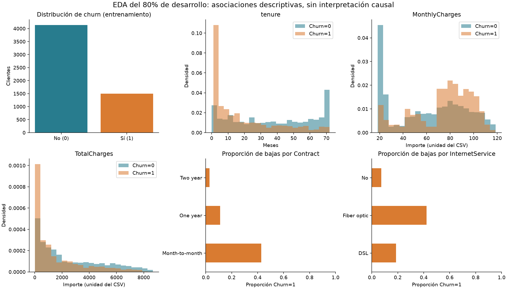
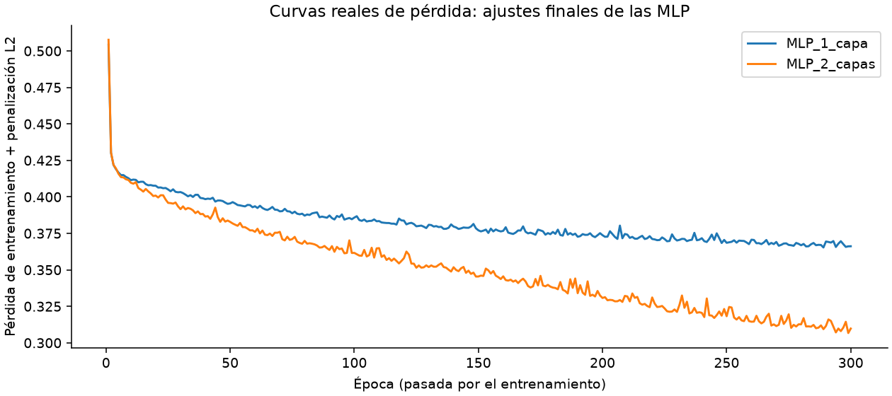
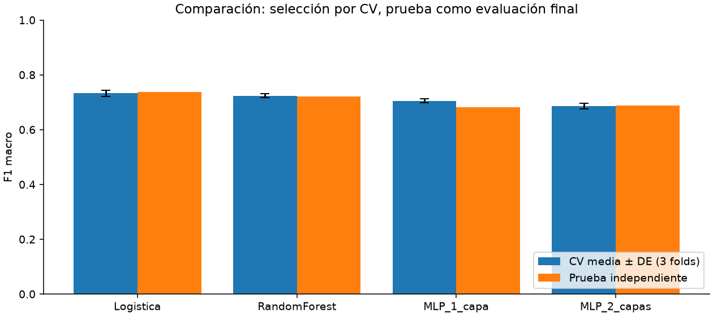
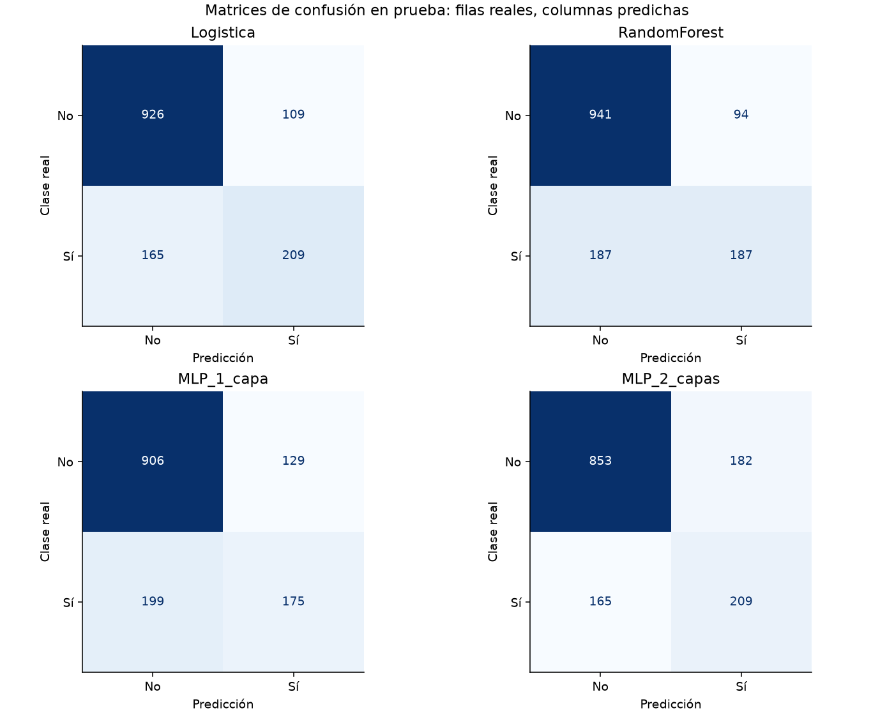

# Trabajo Práctico 01 — Machine Learning: clasificación de bajas de clientes (Churn)

**Materia:** Inteligencia Artificial — 2C — 2026 · **Profesor:** Parkinson, Christian Anibal

**Equipo 8 — Integrantes:**
- Massi, Franco — L.U.: 1156946
- Nari, Agustin Ignacio — L.U.: 1165816
- Vanore, Miqueas — L.U.: 1179980

**Idioma / Language:** [🇦🇷 Español](#español) · [🇬🇧 English](#english)

> El PDF imprimible está en [`informe.pdf`](informe.pdf). La app interactiva, en [`app/`](app/).

---

# Español

## Índice
1. Objetivo y problema · 2. Datos y variables · 3. Metodología y preprocesamiento · 4. Análisis exploratorio · 5. Modelos y redes neuronales · 6. Validación, resultados y comparación · 7. Selección y conclusiones · 8. Limitaciones · 9. Reproducibilidad

## 1. Objetivo y problema

Se busca clasificar si un cliente dejó el servicio, utilizando variables de su perfil, servicios contratados y facturación. Es aprendizaje supervisado de **clasificación binaria**: `Churn=Yes` se codifica como 1 y `No` como 0. La unidad de análisis es un cliente y se comprueba que no hay identificadores repetidos.

La utilidad potencial es orientar un análisis de retención. El archivo carece de fecha de observación y horizonte futuro verificable; por eso los resultados corresponden a **clasificación retrospectiva** de la etiqueta disponible. No demuestran que podamos anticipar una baja en un plazo concreto, ni que intervenir sobre una variable evite la baja.

Según la taxonomía de la Clase 2 (supervisado, no supervisado y por refuerzos), el problema es **supervisado** porque cada instancia trae su etiqueta `Churn`, y dentro de él es **clasificación** —no regresión— porque el objetivo es discreto. Se descartan los demás encuadres: la regresión exigiría un objetivo continuo; la multiclase, más de dos categorías; el no supervisado (clustering, anomalías) ignoraría la etiqueta y respondería otra pregunta (y la baja, 26,5%, no es un evento raro); el refuerzo necesitaría un agente con recompensas. El alternativo más fiel sería el **análisis de supervivencia** (tiempo-al-evento), descartado por la falta de fecha y horizonte.

El dataset Cliente fue indicado expresamente para esta tarea; se respeta la asignación docente.

## 2. Datos y variables

Origen: `Tema - Cliente/Cliente.7z`. Su único CSV tiene **7.043 registros y 21 columnas**. Es un **único dataset** (una tabla); la cátedra no entrega archivos separados de train/test. La **unidad de análisis es el cliente**: cada fila son 20 atributos + la etiqueta `Churn`.

| # | Variable | Qué mide / indica en el cliente | Cómo se guarda | Tipo |
|---|---|---|---|---|
| — | customerID | Código único del cliente | texto (`7590-VHVEG`) | Nominal (ID) |
| 1 | gender | Género registrado | `Male`/`Female` | Nominal binaria |
| 2 | SeniorCitizen | Si es adulto mayor (1) o no (0) | número `0`/`1` | Binaria (num.) |
| 3 | Partner | Si tiene pareja | `Yes`/`No` | Nominal binaria |
| 4 | Dependents | Si tiene personas a cargo | `Yes`/`No` | Nominal binaria |
| 5 | tenure | Meses que lleva en la empresa | número `0`–`72` | Numérica discreta |
| 6 | PhoneService | Si tiene servicio telefónico | `Yes`/`No` | Nominal binaria |
| 7 | MultipleLines | Si tiene más de una línea (o sin telefonía) | 3 valores | Nominal (3) |
| 8 | InternetService | Tipo de internet contratado | `DSL`/`Fiber optic`/`No` | Nominal (3) |
| 9 | OnlineSecurity | Si contrató seguridad online | 3 valores | Nominal (3) |
| 10 | OnlineBackup | Si contrató backup online | 3 valores | Nominal (3) |
| 11 | DeviceProtection | Si contrató protección de dispositivos | 3 valores | Nominal (3) |
| 12 | TechSupport | Si contrató soporte técnico | 3 valores | Nominal (3) |
| 13 | StreamingTV | Si usa streaming de TV | 3 valores | Nominal (3) |
| 14 | StreamingMovies | Si usa streaming de películas | 3 valores | Nominal (3) |
| 15 | Contract | Plazo del contrato | `Month-to-month`/`One year`/`Two year` | Ordinal |
| 16 | PaperlessBilling | Si recibe factura electrónica | `Yes`/`No` | Nominal binaria |
| 17 | PaymentMethod | Medio de pago | 4 valores | Nominal (4) |
| 18 | MonthlyCharges | Importe facturado por mes | número `18,25`–`118,75` | Numérica continua |
| 19 | TotalCharges | Importe total acumulado | número `18,80`–`8.684,80` (11 vacíos) | Numérica continua |
| 20 | Churn | Si se dio de baja | `Yes`/`No` | Binaria (**objetivo**) |

La categoría `No internet/phone service` **no es un faltante**: indica que el cliente no tiene el servicio base. `SeniorCitizen` es un Sí/No guardado como 0/1. Las numéricas vienen como texto. `TotalCharges` trae 11 celdas con espacios, todas con `tenure=0` (ausencia ≠ importe cero). No hay filas ni IDs duplicados. En total: **5.174 No y 1.869 Yes (26,54% de bajas)** → desbalance moderado.

## 3. Metodología y preprocesamiento

Semilla **42**. Antes del EDA se separa un **20% estratificado de prueba (1.409 clientes)**; el desarrollo son **5.634** (4.139 No / 1.495 Yes). Sobre desarrollo se usa `StratifiedKFold(3)`; cada cliente valida una vez y entrena dos. Se comparan 2 configuraciones por modelo y se reajusta la mejor con todo el desarrollo. **El test no se usa para elegir hiperparámetros.**

Cada `Pipeline` tiene un `ColumnTransformer`: numéricas imputadas por **mediana** (aprendida en cada fold) y estandarizadas para logística/MLP; categóricas por moda + **one-hot**. El objetivo y `customerID` quedan afuera.

**Limpieza.** El único problema real es `TotalCharges` (11 vacíos, 0,16%, todos con `tenure=0`): se tipifica a número y se imputa con **mediana en train** (los apuntes la recomiendan para variables sesgadas; media 2.283 ≫ mediana 1.397; evita *leakage*). Se descartan: **eliminar** (pierde datos), **imputar 0** (regla de negocio no verificable), **imputación predictiva** (costo injustificado para 11 valores). No se tratan **outliers** (son valores reales) y **no hay duplicados**.

**Ingeniería de características (evaluada y descartada).** Se probaron `cantidad_servicios` (conteo), `pago_automatico` (binarización) y `Contract` ordinal. Con la misma metodología **no mejoran al modelo elegido** (logística: F1-macro 0,7376 y ROC-AUC 0,8419 sin cambios). Una ablación muestra que solo `pago_automatico` aporta algo a RF/MLP. Por Navaja de Ockham, el pipeline final **no las incluye**; la decisión es empírica, no por omisión.

## 4. Análisis exploratorio

Todo el EDA se calcula **sobre desarrollo** (no se mira el test).

| Variable | Churn=No | Churn=Yes |
|---|---|---|
| tenure (meses) | 37,6 | 18,4 |
| MonthlyCharges | 61,3 | 74,9 |
| TotalCharges | 2.570 | 1.565 |

Tasa de baja por antigüedad: **47,3%** (0–12 m) → 28,6% (13–24) → 20,2% (25–48) → **9,9%** (49–72). Relación no lineal.

**Fuerza de asociación (Cramér's V, chi²):**

| Variable | Cramér's V | Lectura |
|---|---|---|
| Contract | 0,41 | fuerte |
| OnlineSecurity | 0,35 | fuerte |
| TechSupport | 0,35 | fuerte |
| InternetService | 0,33 | fuerte |
| PaymentMethod | 0,31 | moderada-fuerte |
| OnlineBackup / DeviceProtection | 0,29 / 0,28 | moderada |
| StreamingMovies / StreamingTV | 0,23 / 0,23 | moderada |
| PaperlessBilling | 0,20 | débil-moderada |
| Dependents / Partner / SeniorCitizen | 0,17 / 0,15 / 0,15 | débil |
| MultipleLines | 0,04 | muy débil |
| **PhoneService / gender** | **0,02 / 0,00** | **no significativas (p>0,05)** |

**Multivariado:** `tenure`–`TotalCharges` r=0,83 (TotalCharges redundante).

**Conclusiones del AED:** (1) desbalance → medir con F1/recall; (2) drivers = Contract, tenure, InternetService, seguridad/soporte, pago; (3) `gender`/`PhoneService` irrelevantes; (4) colinealidad tenure–TotalCharges; (5) perfil del churner coherente → problema aprendible.



## 5. Modelos y redes neuronales

| Modelo | Ventajas | Limitaciones |
|---|---|---|
| Regresión logística | Interpretable, económica, probabilística | Frontera lineal; sensible a correlaciones |
| Random Forest | Capta interacciones; no exige escala | Caja negra; puede memorizar |
| MLP 1 capa (32 ReLU) | Relaciones no lineales | Menos interpretable; sensible a escala |
| MLP 2 capas (32→16) | Mayor capacidad | Más sobreajuste; no convergió |

Ambas MLP: salida sigmoide, entropía cruzada, L2, Adam (lr 0,001), batch 64, hasta 300 épocas. Entrenamiento por **retropropagación** (regla de la cadena) + Adam.



## 6. Validación, resultados y comparación

Regla previa al test: **máximo F1-macro medio de CV**.

**Qué mide cada métrica** (de la matriz de confusión — TP: baja detectada; FN: baja no detectada; FP: falsa alarma; TN: permanencia acertada):

| Métrica | Técnica | Qué representa |
|---|---|---|
| Accuracy | (TP+TN)/total | aciertos globales; engaña con desbalance |
| Precision (churn) | TP/(TP+FP) | de las alertas, cuántas reales |
| Recall (churn) | TP/(TP+FN) | de las bajas, cuántas detectadas |
| F1 (churn) | 2·P·R/(P+R) | equilibrio precision-recall |
| F1-macro | promedio F1 de ambas clases | **métrica de selección** |
| ROC-AUC | área TPR–FPR | ordenar por riesgo, sin umbral |

**Resultados en prueba (test 20%, umbral 0,5):**

| modelo | accuracy | precision | recall | f1_churn | **f1_macro** | roc_auc |
|---|---|---|---|---|---|---|
| Dummy (mayoritaria) | 0.7346 | 0.000 | 0.000 | 0.000 | 0.4235 | 0.500 |
| **Logística** ⭐ | 0.8055 | 0.6572 | 0.5588 | 0.6040 | **0.7376** | 0.8419 |
| Random Forest | 0.8006 | 0.6655 | 0.5000 | 0.5710 | 0.7205 | 0.8438 |
| MLP 1 capa | 0.7672 | 0.5757 | 0.4679 | 0.5162 | 0.6815 | 0.8232 |
| MLP 2 capas | 0.7537 | 0.5345 | 0.5588 | 0.5464 | 0.6887 | 0.7941 |

**Sobreajuste (brecha train − CV del F1-macro):** Logística 0,005 · RF 0,044 · MLP1 0,090 · MLP2 0,173. A más capacidad, más brecha sin mejorar fuera de entrenamiento.




Matriz del elegido: **TN=926, FP=109, FN=165, TP=209** → detecta 209 de 374 bajas, con 109 falsas alarmas. Las dos MLP **no convergieron** en 300 épocas.

## 7. Selección y conclusiones

La recomendación es **Regresión Logística**, elegida antes de abrir el test por F1-macro de CV **0,7325 ± 0,0115**; en test: accuracy 0,8055, F1-macro 0,7376, recall 0,5588. Combina el mejor F1-macro de CV, la menor brecha de sobreajuste (0,005) y la mayor interpretabilidad. El baseline confirma que predecir la clase mayoritaria no detecta bajas. Más capacidad neuronal exhibió sobreajuste: **caso de Navaja de Ockham**.

## 8. Limitaciones

Una sola partición/semilla/3 folds; búsqueda chica y umbral fijo 0,5; sin fecha ni horizonte (clasificación retrospectiva); no se evaluó calibración, equidad (género/edad) ni costos; la mediana no reconstruye los 11 importes reales; son asociaciones **predictivas, no causales**.

## 9. Reproducibilidad

El dataset de la cátedra **no se versiona** (ver [`data/README.md`](data/README.md)). Para reproducir:

```bash
python3 -m venv .venv
.venv/bin/pip install -r requirements.txt
.venv/bin/python preparar_datos.py        # extrae data/Cliente.csv
.venv/bin/python ejecutar_notebook.py      # entrena y guarda resultados/
# App interactiva (AED + selector de modelos):
.venv/bin/pip install -r app/requirements.txt
.venv/bin/streamlit run app/main.py
```

Resultados verificables en [`resultados/`](resultados/); verificaciones en `test_verificaciones.py`.

---

# English

## Table of contents
1. Goal & problem · 2. Data & variables · 3. Methodology & preprocessing · 4. Exploratory analysis · 5. Models & neural networks · 6. Validation, results & comparison · 7. Selection & conclusions · 8. Limitations · 9. Reproducibility

## 1. Goal and problem

The task is to classify whether a customer left the service, using profile, contracted-services and billing variables. It is **supervised binary classification**: `Churn=Yes` is encoded as 1 and `No` as 0. The unit of analysis is a customer; there are no duplicate identifiers.

The potential use is to guide a retention analysis. The file has no observation date or verifiable future horizon, so the results are **retrospective classification** of the available label — they do not prove we can anticipate churn within a given window, nor that acting on a variable prevents churn.

By the course taxonomy (supervised, unsupervised, reinforcement), this is **supervised** (each instance carries its `Churn` label) and **classification**, not regression, because the target is discrete. Other framings are discarded: regression needs a continuous target; multiclass needs more than two categories; unsupervised (clustering, anomaly detection) would ignore the label (and churn at 26.5% is not a rare event); reinforcement needs an agent with rewards. The closest alternative would be **survival analysis** (time-to-event), ruled out by the lack of date and horizon.

The Cliente dataset was explicitly assigned; the instructor's assignment is respected.

## 2. Data and variables

Source: `Tema - Cliente/Cliente.7z`. Its single CSV has **7,043 rows and 21 columns**. It is a **single dataset** (one table); no separate train/test files are provided. The **unit of analysis is the customer**: each row is 20 attributes + the `Churn` label.

| # | Variable | What it measures about the customer | How it is stored | Type |
|---|---|---|---|---|
| — | customerID | Unique customer code | text (`7590-VHVEG`) | Nominal (ID) |
| 1 | gender | Recorded gender | `Male`/`Female` | Binary nominal |
| 2 | SeniorCitizen | Whether senior (1) or not (0) | number `0`/`1` | Binary (stored as number) |
| 3 | Partner | Has a partner | `Yes`/`No` | Binary nominal |
| 4 | Dependents | Has dependents | `Yes`/`No` | Binary nominal |
| 5 | tenure | Months with the company | number `0`–`72` | Discrete numeric |
| 6 | PhoneService | Has phone service | `Yes`/`No` | Binary nominal |
| 7 | MultipleLines | More than one line (or no phone) | 3 values | Nominal (3) |
| 8 | InternetService | Internet service type | `DSL`/`Fiber optic`/`No` | Nominal (3) |
| 9 | OnlineSecurity | Online security add-on | 3 values | Nominal (3) |
| 10 | OnlineBackup | Online backup add-on | 3 values | Nominal (3) |
| 11 | DeviceProtection | Device protection add-on | 3 values | Nominal (3) |
| 12 | TechSupport | Tech support add-on | 3 values | Nominal (3) |
| 13 | StreamingTV | TV streaming | 3 values | Nominal (3) |
| 14 | StreamingMovies | Movie streaming | 3 values | Nominal (3) |
| 15 | Contract | Contract term | `Month-to-month`/`One year`/`Two year` | Ordinal |
| 16 | PaperlessBilling | Paperless billing | `Yes`/`No` | Binary nominal |
| 17 | PaymentMethod | Payment method | 4 values | Nominal (4) |
| 18 | MonthlyCharges | Monthly billed amount | number `18.25`–`118.75` | Continuous numeric |
| 19 | TotalCharges | Total accrued amount | number `18.80`–`8,684.80` (11 blanks) | Continuous numeric |
| 20 | Churn | Whether the customer left | `Yes`/`No` | Binary (**target**) |

The `No internet/phone service` level is **not missing data**: it records that the customer lacks the base service. `SeniorCitizen` is a Yes/No stored as 0/1. Numeric columns arrive as text. `TotalCharges` has 11 blank cells, all with `tenure=0` (absence ≠ zero amount). No duplicate rows or IDs. Totals: **5,174 No and 1,869 Yes (26.54% churn)** → moderate imbalance.

## 3. Methodology and preprocessing

Seed **42**. Before EDA, a **stratified 20% test set (1,409 customers)** is split off; development is **5,634** (4,139 No / 1,495 Yes). On development, `StratifiedKFold(3)` is used; each customer validates once and trains twice. Two configurations per model are compared and the best is refit on all development. **The test set is never used to pick hyperparameters.**

Each `Pipeline` has a `ColumnTransformer`: numerics imputed by **median** (learned per fold) and standardized for logistic/MLP; categoricals by mode + **one-hot**. Target and `customerID` are excluded.

**Cleaning.** The only real issue is `TotalCharges` (11 blanks, 0.16%, all with `tenure=0`): cast to numeric and imputed with the **training median** (the notes recommend the median for skewed variables; mean 2,283 ≫ median 1,397; avoids leakage). Discarded: **dropping** rows (needless data loss), **imputing 0** (an unverifiable business rule), **predictive imputation** (unjustified cost for 11 values). **Outliers** are not treated (they are real values) and there are **no duplicates**.

**Feature engineering (evaluated and discarded).** `cantidad_servicios` (count), `pago_automatico` (binarization) and ordinal `Contract` were tested. Under the same methodology they **do not improve the chosen model** (logistic: F1-macro 0.7376 and ROC-AUC 0.8419 unchanged). An ablation shows only `pago_automatico` helps RF/MLP slightly. By Occam's razor the final pipeline **excludes them**; the decision is empirical, not an omission.

## 4. Exploratory analysis

All EDA is computed **on development** (the test set is never inspected).

| Variable | Churn=No | Churn=Yes |
|---|---|---|
| tenure (months) | 37.6 | 18.4 |
| MonthlyCharges | 61.3 | 74.9 |
| TotalCharges | 2,570 | 1,565 |

Churn rate by tenure: **47.3%** (0–12 m) → 28.6% (13–24) → 20.2% (25–48) → **9.9%** (49–72). Non-linear.

**Association strength (Cramér's V, chi²):**

| Variable | Cramér's V | Reading |
|---|---|---|
| Contract | 0.41 | strong |
| OnlineSecurity | 0.35 | strong |
| TechSupport | 0.35 | strong |
| InternetService | 0.33 | strong |
| PaymentMethod | 0.31 | moderate-strong |
| OnlineBackup / DeviceProtection | 0.29 / 0.28 | moderate |
| StreamingMovies / StreamingTV | 0.23 / 0.23 | moderate |
| PaperlessBilling | 0.20 | weak-moderate |
| Dependents / Partner / SeniorCitizen | 0.17 / 0.15 / 0.15 | weak |
| MultipleLines | 0.04 | very weak |
| **PhoneService / gender** | **0.02 / 0.00** | **not significant (p>0.05)** |

**Multivariate:** `tenure`–`TotalCharges` r=0.83 (TotalCharges is redundant).

**EDA conclusions:** (1) imbalance → measure with F1/recall; (2) drivers = Contract, tenure, InternetService, security/support, payment; (3) `gender`/`PhoneService` irrelevant; (4) tenure–TotalCharges collinearity; (5) a coherent churner profile → the problem is learnable.


## 5. Models and neural networks

| Model | Strengths | Limitations |
|---|---|---|
| Logistic regression | Interpretable, cheap, probabilistic | Linear boundary; sensitive to correlations |
| Random Forest | Captures interactions; no scaling needed | Black box; can memorize |
| MLP 1 layer (32 ReLU) | Non-linear relations | Less interpretable; scale-sensitive |
| MLP 2 layers (32→16) | Higher capacity | More overfitting; did not converge |

Both MLPs: sigmoid output, cross-entropy, L2, Adam (lr 0.001), batch 64, up to 300 epochs. Trained via **backpropagation** (chain rule) + Adam.


## 6. Validation, results and comparison

Pre-test rule: **maximum mean CV F1-macro**.

**What each metric measures** (from the confusion matrix — TP: churn detected; FN: churn missed; FP: false alarm; TN: correct stay):

| Metric | Formula | Meaning |
|---|---|---|
| Accuracy | (TP+TN)/total | overall hits; misleading under imbalance |
| Precision (churn) | TP/(TP+FP) | of the alerts, how many are real |
| Recall (churn) | TP/(TP+FN) | of the churners, how many detected |
| F1 (churn) | 2·P·R/(P+R) | precision-recall balance |
| F1-macro | mean F1 of both classes | **selection metric** |
| ROC-AUC | area TPR–FPR | ranking by risk, threshold-free |

**Test results (20% test, threshold 0.5):**

| model | accuracy | precision | recall | f1_churn | **f1_macro** | roc_auc |
|---|---|---|---|---|---|---|
| Dummy (majority) | 0.7346 | 0.000 | 0.000 | 0.000 | 0.4235 | 0.500 |
| **Logistic** ⭐ | 0.8055 | 0.6572 | 0.5588 | 0.6040 | **0.7376** | 0.8419 |
| Random Forest | 0.8006 | 0.6655 | 0.5000 | 0.5710 | 0.7205 | 0.8438 |
| MLP 1 layer | 0.7672 | 0.5757 | 0.4679 | 0.5162 | 0.6815 | 0.8232 |
| MLP 2 layers | 0.7537 | 0.5345 | 0.5588 | 0.5464 | 0.6887 | 0.7941 |

**Overfitting (train − CV gap of F1-macro):** Logistic 0.005 · RF 0.044 · MLP1 0.090 · MLP2 0.173. More capacity, larger gap, no gain outside training.


Chosen model's matrix: **TN=926, FP=109, FN=165, TP=209** → detects 209 of 374 churners, with 109 false alarms. Both MLPs **did not converge** in 300 epochs.

## 7. Selection and conclusions

The recommendation is **Logistic Regression**, chosen before opening the test by CV F1-macro **0.7325 ± 0.0115**; on test: accuracy 0.8055, F1-macro 0.7376, recall 0.5588. It combines the best CV F1-macro, the smallest overfitting gap (0.005) and the most interpretability. The baseline confirms that predicting the majority class detects no churn. Added neural capacity showed overfitting: **an Occam's-razor case**.

## 8. Limitations

A single split/seed/3 folds; small search and fixed 0.5 threshold; no date or horizon (retrospective classification); calibration, group fairness (gender/age) and intervention costs were not assessed; the median does not reconstruct the 11 real amounts; results are **predictive associations, not causal**.

## 9. Reproducibility

The course dataset is **not versioned** (see [`data/README.md`](data/README.md)). To reproduce:

```bash
python3 -m venv .venv
.venv/bin/pip install -r requirements.txt
.venv/bin/python preparar_datos.py        # extracts data/Cliente.csv
.venv/bin/python ejecutar_notebook.py      # trains and writes resultados/
# Interactive app (EDA + model switcher):
.venv/bin/pip install -r app/requirements.txt
.venv/bin/streamlit run app/main.py
```

Verifiable outputs in [`resultados/`](resultados/); checks in `test_verificaciones.py`.
