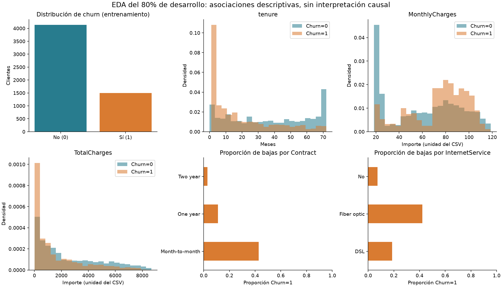
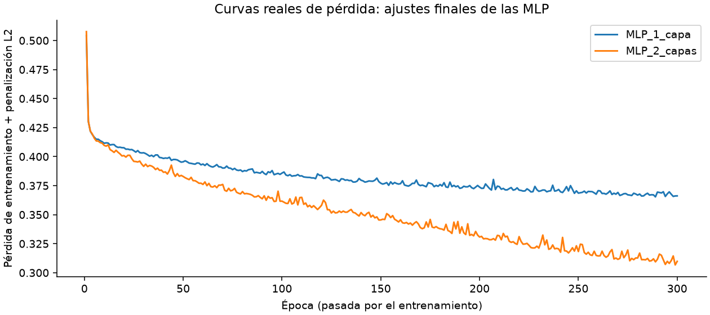
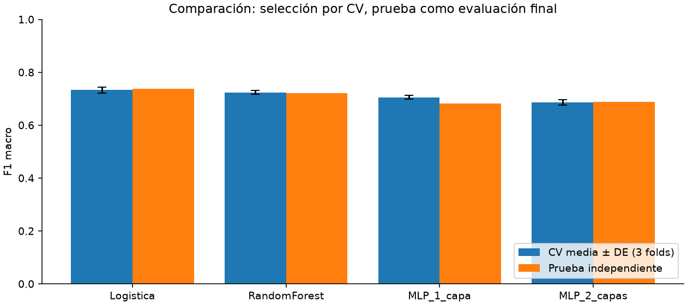
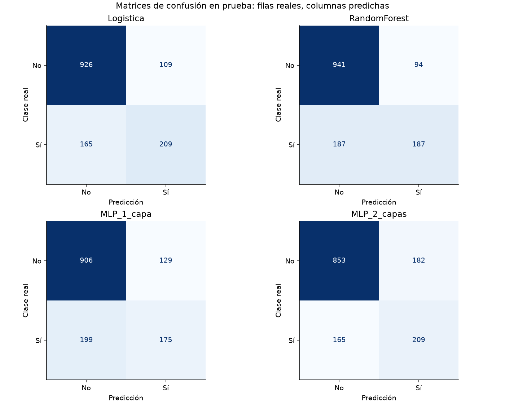

# Trabajo Práctico 01 — Machine Learning: clasificación de bajas de clientes

**Materia:**
- Inteligencia Artificial — 2C — 2026

**Profesor:**
- Parkinson, Christian Anibal

**Equipo 8 — Integrantes:**
- Massi, Franco — L.U.: 1156946
- Nari, Agustin Ignacio — L.U.: 1165816
- Vanore, Miqueas — L.U.: 1179980

*Resultados ejecutados el 21/10/2026. Confirmar fecha de entrega en WebCampus.*

## Índice

1. Objetivo y problema
2. Datos y variables
3. Metodología y preprocesamiento
4. Análisis exploratorio
5. Modelos y redes neuronales
6. Validación, resultados y comparación
7. Selección y conclusiones
8. Limitaciones y trabajo futuro
9. Reproducibilidad y referencias

## 1. Objetivo y problema

Se busca clasificar si un cliente dejó el servicio, utilizando variables de su perfil, servicios contratados y facturación. Es aprendizaje supervisado de clasificación binaria: `Churn=Yes` se codifica como 1 y `No` como 0. La unidad de análisis es un cliente y se comprueba que no hay identificadores repetidos.

La utilidad potencial es orientar un análisis de retención. El archivo carece de fecha de observación y horizonte futuro verificable; por eso los resultados corresponden a clasificación retrospectiva de la etiqueta disponible. No demuestran que podamos anticipar una baja en un plazo concreto, ni que intervenir sobre una variable evite la baja.

Según la taxonomía de la Clase 2 (tipos de aprendizaje: supervisado, no supervisado y por refuerzos), el problema es **supervisado** porque cada instancia trae su etiqueta `Churn`, y dentro de él es **clasificación** —no regresión— porque el objetivo es discreto y no presenta continuidad, que es la regla de distinción de la cátedra. Se descartan los demás encuadres: la regresión exigiría un objetivo continuo (otro target, p. ej. importe o tiempo); la clasificación multiclase requeriría más de dos categorías; el aprendizaje no supervisado (clustering, detección de anomalías, reducción de dimensionalidad) ignoraría la etiqueta disponible y respondería otra pregunta —describir estructura, no predecir la baja—, y además la baja (26,5%) no es un evento raro que justifique detección de anomalías; el aprendizaje por refuerzos necesitaría un agente que recibe recompensas por sus acciones, ausente en una tabla etiquetada estática. El único encuadre supervisado alternativo más fiel sería el **análisis de supervivencia** (tiempo-al-evento), pero queda excluido por la falta de fecha de captura y de horizonte —la misma limitación que obliga a tratar la tarea como clasificación retrospectiva.

El dataset Cliente fue indicado expresamente para esta tarea. La consigna del PDF establece respetar la asignación docente. No se trabaja con las otras tres alternativas del ZIP.

## 2. Datos y variables

Origen: `Tema - Cliente/Cliente.7z`, incluido en `TP 1 - Machine Learning.zip`. Se extrajo su único CSV conservando exactamente los bytes: **7.043 registros y 21 columnas**. La huella SHA-256 y las instrucciones de obtención se encuentran en `docs/data.md`. No se descargaron datos sustitutos.

Es un **único dataset** (una sola tabla); la cátedra no entrega archivos separados de entrenamiento y prueba. La **unidad de análisis es el cliente**: cada fila describe a un cliente con 20 atributos más la etiqueta `Churn`. La tabla siguiente describe **qué mide o indica cada variable** y cómo se guarda en el CSV; el tratamiento posterior (codificación, escala, imputación) se detalla en la §3.

| # | Variable | Qué mide / indica en el cliente | Cómo se guarda | Tipo |
|---|---|---|---|---|
| — | customerID | Código único que identifica al cliente | texto (`7590-VHVEG`) | Nominal (ID) |
| 1 | gender | Género registrado del cliente | texto `Male`/`Female` | Categórica nominal binaria |
| 2 | SeniorCitizen | Si el cliente es adulto mayor (1) o no (0) | número `0`/`1` | Categórica binaria (guardada como número) |
| 3 | Partner | Si el cliente tiene pareja | texto `Yes`/`No` | Categórica nominal binaria |
| 4 | Dependents | Si el cliente tiene personas a cargo (dependientes) | texto `Yes`/`No` | Categórica nominal binaria |
| 5 | tenure | Cantidad de meses que el cliente lleva en la empresa | número `0`–`72` | Numérica discreta |
| 6 | PhoneService | Si tiene contratado servicio telefónico | texto `Yes`/`No` | Categórica nominal binaria |
| 7 | MultipleLines | Si tiene más de una línea telefónica (o no tiene telefonía) | texto `Yes`/`No`/`No phone service` | Categórica nominal (3) |
| 8 | InternetService | Tipo de servicio de internet contratado | texto `DSL`/`Fiber optic`/`No` | Categórica nominal (3) |
| 9 | OnlineSecurity | Si contrató el servicio de seguridad online (o no tiene internet) | texto `Yes`/`No`/`No internet service` | Categórica nominal (3) |
| 10 | OnlineBackup | Si contrató copia de seguridad (backup) online | texto `Yes`/`No`/`No internet service` | Categórica nominal (3) |
| 11 | DeviceProtection | Si contrató protección de dispositivos | texto `Yes`/`No`/`No internet service` | Categórica nominal (3) |
| 12 | TechSupport | Si contrató soporte técnico | texto `Yes`/`No`/`No internet service` | Categórica nominal (3) |
| 13 | StreamingTV | Si usa el servicio de streaming de TV | texto `Yes`/`No`/`No internet service` | Categórica nominal (3) |
| 14 | StreamingMovies | Si usa el servicio de streaming de películas | texto `Yes`/`No`/`No internet service` | Categórica nominal (3) |
| 15 | Contract | Plazo del contrato del cliente | texto `Month-to-month`/`One year`/`Two year` | Categórica ordinal |
| 16 | PaperlessBilling | Si recibe la factura de forma electrónica (sin papel) | texto `Yes`/`No` | Categórica nominal binaria |
| 17 | PaymentMethod | Medio de pago que usa el cliente | texto (4 valores) | Categórica nominal (4) |
| 18 | MonthlyCharges | Importe que se le factura por mes | número `18,25`–`118,75` | Numérica continua |
| 19 | TotalCharges | Importe total acumulado facturado durante su permanencia | número `18,80`–`8.684,80` (11 vacíos) | Numérica continua |
| 20 | Churn | Si el cliente se dio de baja del servicio | texto `Yes`/`No` | Categórica binaria (**objetivo**) |

Los cuatro valores de `PaymentMethod` son `Electronic check`, `Mailed check`, `Bank transfer (automatic)` y `Credit card (automatic)`. La categoría `No internet service` (y `No phone service`) **no es un faltante**: registra que el cliente no tiene el servicio base, y queda determinada por `InternetService`/`PhoneService`. `SeniorCitizen` es conceptualmente un Sí/No pero el CSV la guarda como 0/1. Todas las columnas numéricas vienen guardadas como texto.

El notebook y el HTML originales coinciden en dimensiones, pero escriben `Tenure` con mayúscula; la columna real es `tenure`. `TotalCharges` llega como texto y contiene 11 valores con espacios, aunque la lectura inicial no informa nulos. Al convertirlos se obtienen 11 ausencias, todas con antigüedad cero. La ausencia no permite inferir que el importe real sea cero. No hay filas ni IDs duplicados, ni variables predictoras constantes en entrenamiento. Las categorías `No internet service` se conservan separadas de `No`. No se presupone moneda porque el CSV no la especifica.

En el archivo completo hay **5.174 No y 1.869 Yes (26.54% de bajas)**. Es un desbalance moderado: accuracy puede resultar alta aun sin detectar bajas.

## 3. Metodología y preprocesamiento

Se fija semilla **42** y se separa antes del EDA un **20% estratificado de prueba (1.409 clientes)**. El desarrollo contiene **5.634 clientes**: 4139 No y 1495 Yes. La prueba contiene 1035 No y 374 Yes. La auditoría verifica disjunción y cobertura de los índices. El split aleatorio supone clientes aproximadamente independientes y con distribución comparable; sin fechas no permite evaluar cambios temporales.

Sobre desarrollo se aplica `StratifiedKFold(3, shuffle=True, random_state=42)`: cada fold tiene 1.878 clientes de validación y los otros 3.756 se usan para entrenar. Cada cliente de desarrollo aparece una vez en validación y dos en entrenamiento. Se comparan dos configuraciones por modelo (24 ajustes), y se reajusta la mejor de cada modelo con todo el desarrollo (4 ajustes adicionales). No se usa la prueba para elegir hiperparámetros.

Cada `Pipeline` incluye un `ColumnTransformer`. En cada fold las numéricas se imputan con la mediana de su entrenamiento; logística y MLP además se estandarizan mediante media y desviación aprendidas allí. Random Forest conserva la escala original. Las categóricas tienen imputación por moda defensiva y one-hot con categorías desconocidas toleradas. El objetivo y `customerID` no entran al pipeline. La conversión de espacios a ausencia es determinista y no aprende información del test.

**Limpieza y decisión sobre faltantes.** Siguiendo la taxonomía de datos sucios de los apuntes (valores faltantes, formatos inválidos, duplicados e inconsistencias), el único problema de calidad real es `TotalCharges`: viene como texto y tiene **11 celdas con espacios (0,16%)**, todas con `tenure=0`. Se tipifica a número y esos 11 vacíos se **imputan con la mediana aprendida en el entrenamiento de cada fold**. Se elige la mediana porque los apuntes indican usarla *cuando la variable está sesgada*, y `TotalCharges` lo está (media 2.283 ≫ mediana 1.397); calcularla solo en entrenamiento evita fuga de información (*leakage*). Se descartan las alternativas de forma explícita: **eliminar** los 11 registros es admisible por el bajo porcentaje (<5%), pero pierde datos sin necesidad; **imputar con 0** no es una medida de tendencia central sino una regla de negocio no verificable (ausencia ≠ importe cero); la **imputación predictiva** (KNN/regresión) agrega costo y complejidad injustificados para 11 valores. No se aplica tratamiento de **outliers** (trimming, winsorización o transformación logarítmica): los importes altos son casos reales, no errores, y recortarlos descartaría información válida. No hay **duplicados** —se verificó: 0 filas repetidas y `customerID` único—, por lo que no corresponde deduplicación. La categoría `No internet/phone service` no se trata como faltante porque es información legítima.

No se aplica remuestreo, recorte de outliers, selección supervisada ni reducción dimensional sin necesidad demostrada. Se conserva el desbalance original y se evalúan métricas que distinguen ambas clases. El umbral se fija en **0.5** para todos los modelos. Una optimización de costos o recall sería un experimento adicional exclusivamente sobre desarrollo.

**Ingeniería de características: exploración posterior.** Después de la evaluación original se probaron estas tres transformaciones adicionales. Se conservan por su valor didáctico, separadas del experimento final:

| Característica | Variables de origen | Técnica | Qué aporta (concepto) |
|---|---|---|---|
| `cantidad_servicios` (0–7) | MultipleLines + 6 add-ons de internet | **Conteo** de servicios en `Yes` (característica derivada por dominio) | resume el nivel de "enganche" del cliente en un número |
| `pago_automatico` (0/1) | PaymentMethod | **Binarización** (automático = 1; cheque electrónico/postal = 0) | concentra en una variable la señal del medio de pago |
| `Contract` ordinal | Contract | **Codificación ordinal** (mensual 0 < anual 1 < bianual 2) en vez de one-hot | respeta el orden natural del plazo |

Se reutilizaron la partición y las búsquedas de CV para explorar cada variante, **cuando el test original ya había sido observado**. Sus comparaciones de test son descriptivas de esta muestra, **no una evaluación final independiente ni evidencia de una mejora validada**. No se incorporan al pipeline estable ni se usan para seleccionar de nuevo el modelo. La selección original de logística por CV, anterior a esta exploración, se mantiene intacta.

Con las tres transformaciones, la logística obtiene F1 macro de CV 0.7324 frente a 0.7325 del experimento base; en el test ya observado mantiene F1 macro 0.7376 y ROC-AUC 0.8419 al redondear a cuatro decimales. Las MLP muestran variaciones descriptivas de F1 macro de test de aproximadamente +0.028 y +0.005. Esto no demuestra que la ingeniería mejore su generalización.

La ablación ilustra por qué no debe elegirse con el test: `pago_automatico` aumenta el F1 macro de test de Random Forest aproximadamente 0.013, pero su F1 macro de CV baja de 0.7239 a 0.7183. En la MLP de una capa aumenta aproximadamente 0.032 en ese test y pasa de 0.7054 a 0.7145 en CV; esos scores forman parte de una exploración posterior, no de una nueva selección final. Las tres transformaciones derivan de variables existentes, sin aportar nuevas observaciones. Para las dos primeras, la logística ya puede formar combinaciones lineales de los indicadores one-hot; reemplazar `Contract` por una codificación ordinal además restringe su representación. Esta ingeniería se evaluó pero **no se incorpora a la app ni al pipeline estable**. Se conserva el pipeline original sin reinterpretar retroactivamente su elección; no se afirma que estas alternativas hayan sido validadas de manera independiente.

## 4. Análisis exploratorio

La exploración y las relaciones con churn se calculan exclusivamente sobre desarrollo. Los controles globales de integridad se limitan a esquema, etiquetas y calidad del archivo. Los faltantes de TotalCharges se distribuyen en 8 de desarrollo y 3 de prueba.

| Variable | Mínimo | Media | Mediana | Máximo |
| --- | --- | --- | --- | --- |
| tenure | 0.0000 | 32.4851 | 29.0000 | 72.0000 |
| MonthlyCharges | 18.4000 | 64.9300 | 70.5000 | 118.7500 |
| TotalCharges | 18.8500 | 2302.6043 | 1398.1250 | 8684.8000 |

En entrenamiento la proporción de bajas es 26.54%. Por contrato es 42.75% en mensual, 11.08% en anual y 2.87% en bianual. Son asociaciones descriptivas, no efectos causales: podrían intervenir selección de clientes y otras características. Las distribuciones de antigüedad e importes se muestran por clase. La correlación entre antigüedad y facturación acumulada se revisa, sin eliminar variables automáticamente; la regularización limita complejidad, pero no convierte los coeficientes en estimaciones causales.

### Relación de cada variable con la baja (bivariado, sobre desarrollo)

Quienes se dan de baja tienen, en promedio, **menor antigüedad y mayor cargo mensual**:

| Variable | Churn=No | Churn=Yes |
|---|---|---|
| tenure (meses) | 37,6 | 18,4 |
| MonthlyCharges | 61,3 | 74,9 |
| TotalCharges | 2.570 | 1.565 |

La tasa de baja **cae de forma monótona con la antigüedad**: 47,3% (0–12 meses), 28,6% (13–24), 20,2% (25–48) y 9,9% (49–72); el descenso más fuerte ocurre en el primer año (relación no lineal). Entre las categóricas, las más asociadas a la baja son:

| Variable | Categoría de mayor baja | Categoría de menor baja |
|---|---|---|
| Contract | Month-to-month 42,7% | Two year 2,9% |
| InternetService | Fiber optic 42,1% | No 7,2% |
| OnlineSecurity | No 41,9% | No internet service 7,2% |
| TechSupport | No 41,8% | No internet service 7,2% |
| PaymentMethod | Electronic check 45,7% | Credit card (aut.) 14,9% |
| SeniorCitizen | Sí 41,1% | No 23,7% |
| PaperlessBilling | Yes 33,8% | No 16,0% |
| Partner / Dependents | No 32,8% / 31,4% | Yes 19,9% / 15,2% |

En cambio, **`gender` (26,6% vs 26,4%) y `PhoneService` (26,8% vs 24,2%) casi no discriminan**.

### Fuerza de asociación con la baja (chi-cuadrado y Cramér's V, dev)

Se mide la asociación de cada categórica con `Churn` mediante la prueba de **chi-cuadrado** (Clase 3) y el tamaño de efecto **Cramér's V** (0 = sin asociación, 1 = total). Ordenadas de mayor a menor:

| Variable | Cramér's V | Significancia (p) | Lectura |
|---|---|---|---|
| Contract | 0,41 | ≈1e-207 | fuerte |
| OnlineSecurity | 0,35 | ≈1e-151 | fuerte |
| TechSupport | 0,35 | ≈1e-146 | fuerte |
| InternetService | 0,33 | ≈1e-131 | fuerte |
| PaymentMethod | 0,31 | ≈1e-118 | moderada-fuerte |
| OnlineBackup | 0,29 | ≈1e-106 | moderada |
| DeviceProtection | 0,28 | ≈1e-96 | moderada |
| StreamingMovies | 0,23 | ≈1e-66 | moderada |
| StreamingTV | 0,23 | ≈1e-65 | moderada |
| PaperlessBilling | 0,20 | ≈1e-50 | débil-moderada |
| Dependents | 0,17 | ≈1e-36 | débil |
| Partner | 0,15 | ≈1e-27 | débil |
| SeniorCitizen | 0,15 | ≈1e-27 | débil |
| MultipleLines | 0,04 | 0,004 | muy débil |
| PhoneService | 0,02 | 0,20 | **no significativa** |
| gender | 0,00 | 0,89 | **no significativa** |

En este análisis bivariado no se detecta asociación estadísticamente significativa entre `gender` o `PhoneService` y la baja (p > 0,05). Esto **no demuestra irrelevancia predictiva**, ausencia de interacciones ni justifica descartarlas automáticamente; ambas se conservan en el pipeline. Las de mayor peso descriptivo son `Contract`, los servicios de seguridad/soporte, el tipo de internet y el medio de pago.

### Relaciones entre variables (multivariado)

`tenure` y `TotalCharges` están fuertemente correlacionadas (r = 0,83), y `MonthlyCharges` con `TotalCharges` (r = 0,65): hay información compartida entre estas variables, sin que la correlación pruebe redundancia total. El nivel `No internet service` se repite en seis variables de servicios y queda determinado por `InternetService`.

### Conclusiones descriptivas del EDA

1. El desbalance moderado (26,5%) exige medir con **F1 y recall**, no solo accuracy.
2. Los ejes informativos son `Contract`, `tenure`, `InternetService`, seguridad/soporte y medio de pago; `gender` y `PhoneService` muestran poca asociación bivariada, sin demostrar irrelevancia predictiva.
3. La **colinealidad** `tenure`–`TotalCharges` dificultará interpretar los coeficientes de la logística; los árboles no requieren predictores independientes, pero las variables correlacionadas pueden repartirse la importancia.
4. La **no linealidad** de `tenure` justifica la opción de discretizarla para modelos lineales.
5. El **perfil del que se da de baja** es coherente (contrato mensual, fibra, cheque electrónico, poca antigüedad, sin seguridad/soporte): el problema es aprendible, con separación buena pero no perfecta.
6. Fuera de los 11 vacíos de `TotalCharges`, los controles no detectaron otros problemas que requieran limpieza. No se recortan valores por ser extremos sin evidencia de error.

## 5. Modelos y redes neuronales

| Modelo | Configuraciones y ventajas | Limitaciones |
|---|---|---|
| Regresión logística | L2; C=0.1 o 1; interpretable y económica; salida probabilística | Frontera lineal en los predictores transformados; coeficientes sensibles a correlaciones |
| Random Forest | 200 árboles; profundidad 8 o sin límite; mínimo 5 por hoja; captura interacciones y no exige escala | Más costoso y menos transparente; puede memorizar; las importancias no son causas |
| MLP de una capa | 32 neuronas ReLU; relaciones no lineales; complejidad moderada | Menor interpretabilidad, sensibilidad a escala e inicialización |
| MLP de dos capas | 32 y 16 neuronas ReLU; composiciones no lineales | Más parámetros y riesgo de sobreajuste; más profundidad no garantiza mejor generalización |

Random Forest utiliza bootstrap y aleatoriedad en características; combina las probabilidades de sus árboles, **no selecciona únicamente el árbol de mayor score**.

Ambas MLP usan una salida sigmoide, entropía cruzada y penalización L2; Adam, learning rate inicial 0.001, batch de 64 y hasta 300 épocas. Se prueban alpha=0.001 y 0.01. La parada se basa en falta de mejora de la pérdida de entrenamiento (tol=0.0001, más de 20 épocas), sin validación interna. Se limita el sobreajuste con arquitecturas pequeñas, L2 y número acotado de épocas; el efecto se contrasta con CV, no con la pérdida de entrenamiento sola.

| Modelo | Entradas | Ocultas | Parámetros | Épocas | Alpha |
| --- | --- | --- | --- | --- | --- |
| MLP_1_capa | 46 | [32] | 1537 | 300 | 0.0100 |
| MLP_2_capas | 46 | [32, 16] | 2049 | 300 | 0.0100 |

La propagación hacia adelante calcula activaciones; la pérdida mide discrepancia frente a las etiquetas. Backpropagation aplica la regla de la cadena desde la salida hacia las capas previas para obtener gradientes respecto de pesos y sesgos. El optimizador actualiza parámetros: el descenso básico resta el learning rate multiplicado por el gradiente; Adam adapta el paso con momentos de los gradientes. Se repite por mini-batches; una época recorre entrenamiento completo. Se utiliza la implementación estándar de scikit-learn. La segunda arquitectura cambia profundidad y cantidad de parámetros: no es una prueba aislada del efecto de profundidad.

## 6. Validación, resultados y comparación

Esta sección corresponde exclusivamente al **experimento original sin FE**, cuya selección se realizó por CV antes de observar el test. La exploración posterior de características descrita en la §3 no altera esta selección ni convierte sus propios resultados de test en una nueva evaluación independiente.

La regla previa al test es **maximizar F1 macro medio de CV**; empates exactos conservan el orden de candidatos declarado. F1 macro es el promedio del F1 de ambas clases; F1 combina precision y recall mediante 2PR/(P+R). Precision de churn mide bajas reales entre alertas, recall mide bajas detectadas entre todas las bajas reales. Se informa también accuracy, ROC-AUC y average precision, sin usarlas para cambiar la regla de selección.

**Qué mide cada métrica.** Accuracy, precision, recall y F1 se calculan a partir de la matriz de confusión al umbral fijado (TP: baja detectada; FN: baja no detectada; FP: falsa alarma; TN: permanencia acertada). ROC-AUC y average precision requieren probabilidades o puntuaciones de riesgo y consideran distintos umbrales; no se obtienen de una única matriz al umbral 0.5.

| Métrica | Definición técnica | Qué representa en el problema |
|---|---|---|
| Accuracy | (TP+TN)/total | proporción de aciertos global; puede ocultar fallos en la minoritaria (el baseline alcanza 0,735 sin detectar bajas) |
| Precision (churn) | TP/(TP+FP) | de las alertas de baja, cuántas son reales; no cuantifica por sí sola su costo económico |
| Recall (churn) | TP/(TP+FN) | de las bajas reales, cuántas se detectan; mide la cobertura de detección |
| F1 (churn) | media armónica 2·P·R/(P+R) | equilibrio precision-recall de la clase minoritaria; penaliza el desbalance entre ambas |
| F1 macro | promedio del F1 de ambas clases | desempeño equilibrado entre clases; es la **métrica de selección** elegida por el desbalance |
| ROC-AUC | área bajo la curva TPR–FPR | capacidad de ordenar clientes por riesgo con independencia del umbral (0,5 = azar, 1 = perfecto) |
| Average precision | suma de precision ponderada por incrementos de recall | resume la curva precision-recall, sin interpolación trapezoidal; enfocada en las bajas |

| modelo | parametros | cv_f1_macro | cv_f1_macro_std | train_f1_macro | busqueda_y_refit_s | refit_s |
| --- | --- | --- | --- | --- | --- | --- |
| Logistica | {"modelo__C": 1.0} | 0.7325 | 0.0115 | 0.7375 | 0.5420 | 0.0436 |
| RandomForest | {"modelo__max_depth": 8} | 0.7239 | 0.0065 | 0.7681 | 4.4540 | 0.6231 |
| MLP_1_capa | {"modelo__alpha": 0.01} | 0.7054 | 0.0075 | 0.7951 | 35.2855 | 7.3785 |
| MLP_2_capas | {"modelo__alpha": 0.01} | 0.6860 | 0.0098 | 0.8587 | 47.4751 | 9.7806 |

**Cómo se mide el sobreajuste (overfitting).** Se compara el desempeño en entrenamiento contra el de datos no vistos (la CV): la **brecha** entre ambos es el indicador. Una brecha grande es un indicio de sobreajuste. Una brecha pequeña por sí sola no demuestra buen rendimiento: ambos scores podrían ser bajos; deben evaluarse junto con su magnitud. Con el F1 macro (train − CV): Logística 0.005, Random Forest 0.044, MLP de una capa 0.090 y MLP de dos capas 0.173. A mayor capacidad del modelo, mayor brecha, sin mejora fuera de entrenamiento: evidencia de sobreajuste que respalda elegir el modelo más simple.

La desviación estándar de tres folds describe variabilidad; no es un intervalo de confianza ni una prueba de significación. El score del ganador tiene posible optimismo por selección. El tiempo de búsqueda incluye los seis ajustes de CV de esa familia y su refit; `refit_s` mide solo el ajuste final. Los tiempos pertenecen a esta máquina, con un hilo para los modelos y las bibliotecas numéricas durante el entrenamiento.

Con las decisiones fijadas, se evalúan los cuatro pipelines sobre la misma prueba y se añade un baseline mayoritario. La tabla no se usa para reajustar ni cambiar el ganador.

| modelo | accuracy | precision_churn | recall_churn | f1_churn | f1_macro | roc_auc | average_precision |
| --- | --- | --- | --- | --- | --- | --- | --- |
| Dummy_mayoritaria | 0.7346 | 0.0000 | 0.0000 | 0.0000 | 0.4235 | 0.5000 | 0.2654 |
| Logistica | 0.8055 | 0.6572 | 0.5588 | 0.6040 | 0.7376 | 0.8419 | 0.6338 |
| RandomForest | 0.8006 | 0.6655 | 0.5000 | 0.5710 | 0.7205 | 0.8438 | 0.6593 |
| MLP_1_capa | 0.7672 | 0.5757 | 0.4679 | 0.5162 | 0.6815 | 0.8232 | 0.6066 |
| MLP_2_capas | 0.7537 | 0.5345 | 0.5588 | 0.5464 | 0.6887 | 0.7941 | 0.5637 |

El modelo elegido tiene **TN=926, FP=109, FN=165, TP=209**. Por tanto detecta 209 de 374 bajas y genera 109 alertas falsas; no detecta 165 bajas. Estas cantidades permiten explicar el compromiso entre detección y falsas alarmas. No se deduce rentabilidad sin costos reales de contacto, retención y baja.

Estado de entrenamiento:

- Logistica: sin advertencias
- RandomForest: sin advertencias
- MLP_1_capa: Stochastic Optimizer: Maximum iterations (300) reached and the optimization hasn't converged yet.
- MLP_2_capas: Stochastic Optimizer: Maximum iterations (300) reached and the optimization hasn't converged yet.

Las dos MLP llegaron al máximo de 300 épocas: **no se declara convergencia del optimizador**. Los resultados corresponden al presupuesto fijado, no a redes plenamente optimizadas. No se modifica el entrenamiento después de ver test. Esta limitación forma parte de la comparación.

## 7. Selección y conclusiones

La recomendación académica es **Logistica**, seleccionado antes de abrir la prueba por F1 macro de CV **0.7325 ± 0.0115**. En prueba obtiene **accuracy 0.8055, F1 macro 0.7376, precision de churn 0.6572, recall 0.5588 y F1 de churn 0.6040**. Su entrenamiento final demandó 0.044 segundos en esta ejecución.

Logística combina el mayor F1 macro de CV con el menor tiempo de ajuste final y mayor facilidad de explicación. Su brecha media train–CV es 0.0050, frente a 0.0441 en Random Forest, 0.0897 en MLP de una capa y 0.1727 en MLP de dos capas. El aumento de capacidad neuronal exhibe sobreajuste en estas configuraciones.

Se compara rendimiento junto con generalización, interpretabilidad y costo: el máximo de CV fundamenta la elección, y las brechas entrenamiento-CV advierten sobreajuste. Una diferencia pequeña entre modelos no acredita superioridad universal. El baseline deja visible que predecir la clase dominante no resuelve la detección de bajas. Las dos arquitecturas neuronales permiten verificar que mayor capacidad puede bajar la pérdida de entrenamiento sin mejorar el score fuera de entrenamiento.

El experimento cubre tres familias de algoritmos, dos arquitecturas neuronales, tratamiento explícito de faltantes, separación independiente y resultados verificables. La selección final conserva el criterio previo, aun si otro modelo obtiene un test mayor en esta partición.

## 8. Limitaciones y trabajo futuro

- Una sola partición externa, una semilla y tres folds: no se cuantifica toda la incertidumbre.
- Búsqueda pequeña y umbral fijo: no implica alcanzar el mejor modelo posible.
- Sin fechas ni horizonte verificable: falta comprobar que los atributos estén disponibles antes de la baja. Se requiere una cohorte posterior para evaluar anticipación.
- Muestra y contexto de la cátedra: no se presume representatividad de otra empresa o población.
- No se evaluaron calibración, equidad por grupo ni costos de intervención; incluir género y edad exige revisión para uso real.
- La mediana es una solución prudente para los 11 importes ausentes, pero no reconstruye su valor real.
- Los resultados son asociaciones predictivas, sin inferencia causal sobre medidas de retención.

Antes de otro experimento habría que definir horizonte, fecha de observación y costos. Toda modificación se debe validar sin reutilizar esta prueba como herramienta de ajuste. Una vez usada para orientar decisiones posteriores, haría falta una prueba externa nueva.

## 9. Reproducibilidad y referencias

El README contiene comandos de Windows 11 para crear el entorno, extraer Cliente, ejecutar la notebook y correr pruebas. `requirements.txt` fija las dependencias principales y numéricas; las versiones efectivamente usadas se guardan en `resultados/experimento.json`. La notebook ejecuta todos los pasos y comparte funciones con la versión de consola, sin cargar métricas preexistentes.

Se guardan CSV de validación, selección y prueba, predicciones sin IDs para recalcular métricas, controles e índices de la partición, métricas por clase, matrices, curvas y figuras. No se guardan modelos entrenados grandes en Git; el `Cliente.csv` (dataset público Telco Churn) sí se versiona para que la app y el deploy funcionen sin pasos previos. `test_verificaciones.py` comprueba datos, separación/folds, ajuste de transformaciones solo con entrenamiento, métricas recalculadas, elección por CV y ejecución íntegra de la notebook.

Materiales locales revisados:

1. **C221-TPI-MachineLearning.pdf**, pp. 1–2: objetivos, tareas y exposición. La versión del ZIP está fechada CII 2023; cursada y plazo actual deben confirmarse.
2. **Dataset_no_te_vayas.ipynb / Dataset_Cliente.html**: descripción contrastada con el CSV real.
3. **2. Machine Learning.pdf**, pp. 13–30, 62–64, 115–119: proceso, generalización, logística y bosques.
4. **3. Ingeniería de las características.pdf**, pp. 36–45 y 50–64: codificación, escala, validación y métricas.
5. **4. Deep Learning.pdf**, pp. 59–81 y 85–97: MLP, entrenamiento y retropropagación.
6. **Apuntes - Inteligencia Artificial (2).docx**, secciones de ML e ingeniería de características: decisiones, comparación y costo; se aclaran las dudas informales sobre bosques y CV.

`Clase 6.pdf` trata Desarrollo de Aplicaciones II (integración y microservicios), no este tema, y no se usa como base metodológica. Para el detalle exacto de la implementación se pueden consultar los docstrings instalados de scikit-learn, coherentes con las versiones registradas.

Además, en `app/` se incluye una **aplicación Streamlit** (`streamlit run app/main.py`) que muestra el AED en la página principal y permite **cambiar de modelo** para entrenarlo y evaluarlo con la misma metodología. Su lógica está separada por responsabilidad: `carga`, `limpieza`, `procesamiento`, `aed` y un archivo por modelo en `app/src/modelos/`. Ver `docs/app.md`.

La notebook, la app y la guía oral constituyen soporte para la exposición. Quedan a cargo del grupo la revisión personal y entregar el código y soporte en WebCampus.
